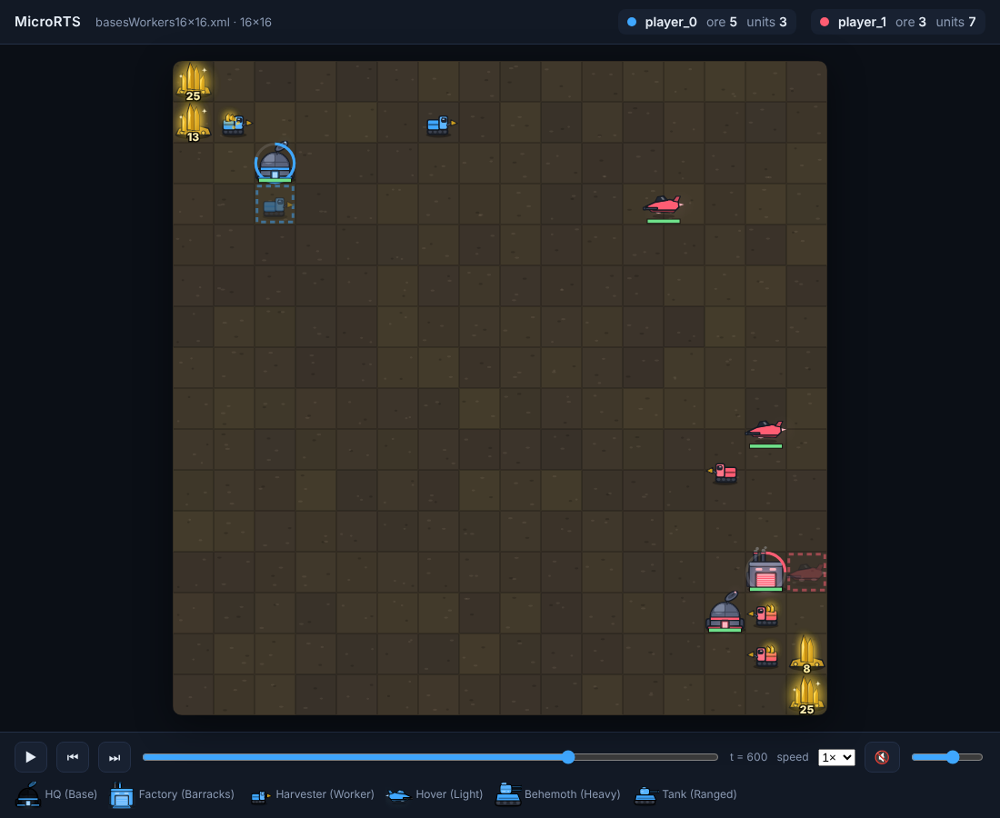

# MicroRTS for PettingZoo

[MicroRTS](https://github.com/Farama-Foundation/MicroRTS) as a
[PettingZoo](https://pettingzoo.farama.org/) multi-agent environment, with
the *gridnet* interface of [Gym-µRTS / MicroRTS-Py](https://github.com/Farama-Foundation/MicroRTS-Py)
and a browser viewer with sound.

- **PettingZoo-native.** A `ParallelEnv` (both players act every tick) plus
  the AEC version via PettingZoo's own conversion. Passes `parallel_api_test`,
  `api_test`, `seed_test`, `parallel_seed_test` and `render_test`.
- **No JVM.** The MicroRTS engine is ported to pure Python/NumPy, so
  `pip install` is all you need. The port is checked tick for tick against the
  reference Java engine (see [Parity](#parity-with-the-java-engine)).
- **Action masks** in every observation, in the layout PettingZoo's tools
  expect.
- **Viewer.** An HTML canvas renderer with animated units, effects and
  synthesised sound. It works live while you train or play, or as a
  self-contained replay file you can share.



**Website and live sample replay:** https://crunchy000.github.io/petting-zoo-micro-rts/ (deployed from [`docs/site`](docs/site) by the `pages` workflow).

## Install

```bash
pip install -e .            # numpy, gymnasium, pettingzoo
pip install -e ".[test]"    # + pytest
```

## Quick start

```python
from microrts_pz import microrts_v0

env = microrts_v0.parallel_env(map_path="maps/16x16/basesWorkers16x16.xml", max_steps=2000)
observations, infos = env.reset(seed=42)

while env.agents:
    actions = {
        agent: env.action_space(agent).sample(observations[agent]["action_mask"])
        for agent in env.agents
    }
    observations, rewards, terminations, truncations, infos = env.step(actions)
env.close()
```

The AEC version uses the standard PettingZoo loop:

```python
env = microrts_v0.env(map_path="maps/8x8/basesWorkers8x8A.xml")
env.reset(seed=0)
for agent in env.agent_iter():
    obs, reward, termination, truncation, info = env.last()
    action = None if termination or truncation else env.action_space(agent).sample(obs["action_mask"])
    env.step(action)
```

## Environment

| | |
|---|---|
| Agents | `player_0`, `player_1` (simultaneous moves) |
| Action space | `GridnetActionSpace`, a flat `MultiDiscrete` of shape `(H*W*7,)` |
| Observation space | `Dict(observation=Box(0, 1, (H, W, 29), int8), action_mask=Box(0, 1, (H*W*78,), int8))` |
| State | `env.state()`: fully observed planes from player 0's view, `(H, W, 29)` |
| Termination | one side has no units left (`infos[agent]["winner"]` names the winner) |
| Truncation | `max_steps` ticks (default 2000) |

**Actions.** Each map cell carries one 7-part action that is read only if the
cell holds an idle unit of the acting player:

| component | values |
|---|---|
| action type | 0 wait, 1 move, 2 harvest, 3 return, 4 produce, 5 attack |
| move direction | 0 up, 1 right, 2 down, 3 left |
| harvest direction | 0–3 |
| return direction | 0–3 |
| produce direction | 0–3 |
| produce unit type | 0 Resource, 1 Base, 2 Barracks, 3 Worker, 4 Light, 5 Heavy, 6 Ranged |
| attack target | 0–48, a cell in the 7×7 square centred on the unit (index `(dy+3)*7 + (dx+3)`) |

Units are busy for the length of their action (a worker takes 10 ticks to
move one cell, a base 250 ticks to train a worker). Illegal actions turn
into a wait of the same length, exactly as in MicroRTS, so use the mask.

**Action mask.** For each cell, the valid values of each component,
concatenated (6+4+4+4+4+7+49 = 78 entries), flattened over cells. Cells
without an idle unit of the agent are all zero.
`env.action_space(agent).sample(mask)` samples only valid values.

**Observation.** One-hot planes per cell: hit points (0–4+), resources
(0–4+), owner (none/self/enemy, from the observer's point of view), unit type
(none + 7), current action (6) and terrain (2). With `partial_obs=True`,
enemies and resources outside your units' sight radius are hidden and two
extra binary planes give your and the visible enemies' fields of view
(31 channels).

**Rewards.** `infos[agent]["raw_rewards"]` holds the six reward components of
MicroRTS-Py, in order `win_loss` (±1 at game end), `resource_gather`,
`produce_worker`, `produce_building`, `attack` and `produce_combat_unit`. Like
the reference engine, the shaped components count actions when they are
issued. The scalar reward is `reward_weight @ raw_rewards`, and
`reward_weight` defaults to `(10, 1, 1, 0.2, 1, 4)`, the weights used by
CleanRL's MicroRTS baselines. Pass `reward_weight=(1, 0, 0, 0, 0, 0)` for
pure win/loss.

**Options** (keyword arguments to `parallel_env` / `env`):

| argument | default | |
|---|---|---|
| `map_path` | `maps/16x16/basesWorkers16x16.xml` | any bundled map (`microrts_pz.list_maps()`) or path to a MicroRTS map XML |
| `max_steps` | `2000` | truncation horizon in ticks |
| `reward_weight` | `(10, 1, 1, 0.2, 1, 4)` | see above |
| `partial_obs` | `False` | fog of war |
| `unit_type_table_version` | `1` | 1 original, 2 fine-tuned, 3 random damage |
| `move_conflict_resolution` | `1` | 1 cancel both, 2 cancel one at random, 3 alternate |
| `render_mode` | `None` | `"human"`, `"rgb_array"` or `"ansi"` |
| `record_replay` | `False` | keep frames for `env.save_replay(path)` |

## Viewer

**Replays.** Record an episode and write one HTML file. It has no external
dependencies, so you can open it anywhere or attach it to a report:

```python
env = microrts_v0.parallel_env(record_replay=True)
env.reset(seed=0)
...  # play
env.save_replay("game.html")
```

**Live.** `render_mode="human"` starts a small local server on 127.0.0.1,
opens the viewer in your browser and streams every tick to it. You can pause
and scrub back while the game keeps running. Set `MICRORTS_NO_BROWSER=1` to
skip opening a browser, and pass `viewer_port=` to pick the port.

```bash
python examples/replay_bots.py --out replay.html    # mixed armies, every unit type, saved
python examples/replay_bots.py --live               # the same game, live
```

Controls: space plays/pauses, ←/→ step, `+`/`-` change speed and `m`
toggles sound. Hover a unit to see its stats. Sound effects (attacks, hits,
deaths, production, harvesting, deposits, victory) are generated with the Web
Audio API and panned by map position. Browsers only allow audio after a
click, so press 🔇 to turn it on.

`rgb_array` returns a NumPy image, for video recording. `ansi` returns a
text board.

## Bots

`microrts_pz.bots` has `RandomBot` (random valid actions) and `WorkerRushBot`,
which can also build barracks and rush with Light, Heavy or Ranged units
(or cycle through several, e.g. `army=("Light", "Heavy", "Ranged")`).
These are sparring partners for testing. They read the engine state
directly and are not tuned AIs.

```python
from microrts_pz.bots import WorkerRushBot
bot = WorkerRushBot(harvesters=2, army="Light")
actions["player_1"] = bot.act(env.unwrapped.game, player=1).reshape(-1)
```

## Parity with the Java engine

`tools/parity/check_parity.py` compiles the reference MicroRTS engine and a
small harness ([`ParityHarness.java`](tools/parity/ParityHarness.java)). It then plays
random games through both engines with identical actions and compares, every
tick, both players' observations, action masks (including the source-unit
mask), all six raw reward components, player resources and game-over. The
actions are mostly masked, with about 10% uniformly random so that
illegal-action handling is also tested.

```bash
git clone https://github.com/Farama-Foundation/MicroRTS /tmp/MicroRTS
python tools/parity/check_parity.py --microrts /tmp/MicroRTS --episodes 2 --steps 1500
```

The default sweep (7 maps, unit-table versions 1 and 2, full and partial
observability) matches the Java engine on every tick. CI runs it whenever
the engine, unit table or maps change. The port keeps the Java engine's
quirks so trajectories match, for example:

- Player 0's actions are issued first, so a player 1 move into a cell that
  player 0 just claimed is dropped.
- A unit killed during a tick still completes the action it had finishing
  that tick, so simultaneous attacks both land.
- Production is paid when it completes, not when it starts.

There is one intentional difference. With `partial_obs=True`, the Java client
builds the observation from a snapshot taken *before* the tick (dead units
still appear and the actions issued that tick are missing). This port
observes the state after the tick. The parity harness compares against a
fresh Java snapshot for that reason.

## Training agents

`training/` has a PPO trainer with invalid-action masking and self-play
(`train_selfplay.py`), an evaluator that records HTML replays (`play.py`) and
a Colab notebook. A trained 16×16 agent ships in `training/agents/agent_16x16.pt`.
It had about 16M steps, roughly three hours on one Colab L4. It wins about 60%
of games against the mixed-army bot, 75% against Ranged and 100% against Heavy,
but loses most games to the Light rush. The sample games on the website come
from it.

```bash
pip install -e ".[train]"        # torch + numba
python training/train_selfplay.py --map maps/16x16/basesWorkers16x16.xml --bc-steps 2000000 --out runs/16x16
python training/play.py training/agents/agent_16x16.pt --opponent mixed --games 10 --record replays/
```

### Fast batched engine

For training there is a compiled batch engine, `microrts_pz.fast.BatchGame`
(`pip install -e ".[fast]"`, which adds Numba). It steps many games of one map
size in a single call spread over all CPU cores, returns observations, masks
and rewards as arrays, and includes compiled versions of the scripted bots.
`tests/test_fast.py` checks it against `engine.py` tick by tick (observations,
masks, rewards, game over and bot moves). On a 4-core machine it runs about
95,000 ticks per second on 16×16 maps with both bots playing, against roughly
5,000 per core for the pure-Python engine. It covers fully observed games
with the deterministic unit tables; use the PettingZoo env for the rest.

### Why not JAX (yet)

MicroRTS's rules depend on order: actions resolve sequentially, conflicts are
settled by issue order, and units killed mid-tick still act. Reproducing that
exactly in a jit-compiled, fixed-shape JAX kernel is a substantial project of
its own, and exact parity was the priority here. The engine is small
(`engine.py`) and parity-tested, so it can serve as the reference for a later
`jax`/`vmap` backend, checked with the same tick-by-tick tests as the Numba one.

## Differences from MicroRTS-Py

- PettingZoo Parallel/AEC API with Gymnasium spaces, instead of a Gym 0.x
  VecEnv and an AECEnv wrapper that no longer runs.
- No Java/JPype dependency and no build step.
- Action masks come with every observation, flattened for PettingZoo's
  tooling. The upstream per-cell `(H*W, 78)` layout is just a reshape away.
- The upstream `reward_weight` default was `(0, 1, 0, 0, 0, 5)`. Here it
  is `(10, 1, 1, 0.2, 1, 4)` (see above).
- Scripted Java AIs (CoacAI, Mayari, …) are not included. `bots.py` has
  simple Python opponents instead.

## License

GPL-3.0 ([`LICENSE`](LICENSE)). The engine and the bundled maps are derived
from MicroRTS, which is GPL-3.0. The interface design follows MicroRTS-Py,
which is MIT, and its notice is kept in
[`THIRD_PARTY_NOTICES.md`](THIRD_PARTY_NOTICES.md). Anything that
distributes a modified version of this package, or bundles it into a larger
program, must therefore also be distributed under the GPL-3.0. Training
policies with it and publishing results or model weights is not
distribution of the program and is not affected.

## Citing

If you use this environment, please cite MicroRTS and Gym-µRTS:

```bibtex
@inproceedings{ontanon2013combinatorial,
  author    = {Santiago Onta{\~{n}}{\'{o}}n},
  title     = {The Combinatorial Multi-Armed Bandit Problem and Its Application to Real-Time Strategy Games},
  booktitle = {Proceedings of the Ninth AAAI Conference on Artificial Intelligence and Interactive Digital Entertainment (AIIDE)},
  pages     = {58--64},
  year      = {2013}
}

@inproceedings{huang2021gym,
  author    = {Shengyi Huang and Santiago Onta{\~{n}}{\'{o}}n and Chris Bamford and Lukasz Grela},
  title     = {Gym-{\(\mathrm{\mu}\)}RTS: Toward Affordable Full Game Real-time Strategy Games Research with Deep Reinforcement Learning},
  booktitle = {2021 {IEEE} Conference on Games (CoG)},
  pages     = {671--678},
  year      = {2021},
  doi       = {10.1109/CoG52621.2021.9619076}
}
```
